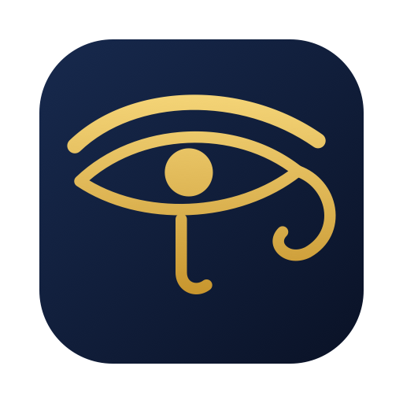
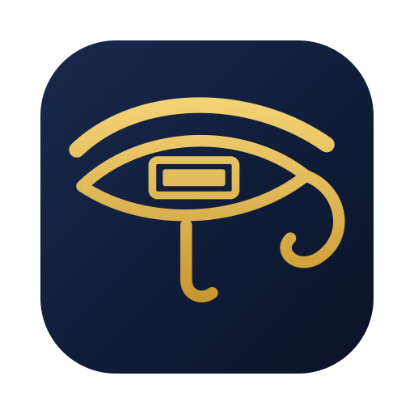
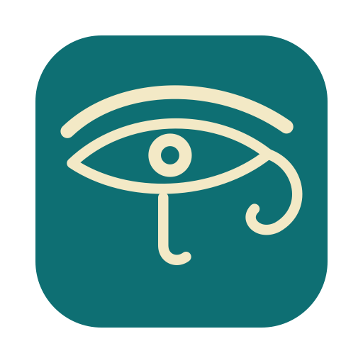

<div align="center">



# U D J A T H

### A resolução do ecrã, na barra de menu.
*Display resolution, in the menu bar.*

**Um clique para mudar, reversão automática se correr mal. Sem conta, sem rede, sem telemetria.**<br>
*One click to switch, automatic revert if it goes wrong. No account, no network, no telemetry.*

<br>

[](../../releases/latest)
[](https://lestatpirate.github.io/udjath/)
[](LICENSE)
[](https://paypal.me/lestat013)

[Português](#português) &nbsp;·&nbsp; [English](#english)

</div>

<br>

## Português

App de barra de menu para macOS que muda a resolução do ecrã (interno ou externo) para as resoluções mais comuns, incluindo ultrawide como **3440x1440**. Depois de mudar, pede confirmação com contagem decrescente: sem resposta, volta sozinha à resolução anterior, como o próprio macOS faz em Definições → Ecrãs.

*Udjath* vem de *udjat*, o Olho de Hórus da mitologia egípcia: símbolo de visão e proteção, e o desenho do ícone da app.

### Funcionalidades

- **Todos os ecrãs num menu**, com a resolução atual assinalada. A app não tem ícone no Dock.
- **Resoluções comuns pré-definidas** (1920x1080, 2560x1440, 3440x1440, 3840x2160, entre outras). As que o ecrã ligado não suporta aparecem desativadas.
- **Modos HiDPI escondidos**: mostra as resoluções escaladas que o macOS não apresenta por omissão.
- **Reversão automática**: 15 segundos para confirmar a nova resolução; senão, volta à anterior.
- **Renomear um ecrã** ao nível do sistema (ver abaixo).
- **Ícones à escolha** no menu **Ícone**: o ícone da app (Clássico, Ultrawide ou Turquesa) e o da barra de menu (Olho de Hórus, com pupila ou com ecrã).
- **100 % local**: não faz pedidos de rede.

<div align="center">
 &nbsp;  &nbsp; 
</div>

### Instalação

1. Descarregue o zip da [última versão](../../releases/latest), descomprima e arraste `Udjath.app` para Aplicações. Apple Silicon e Intel.
2. A app não está notarizada: na primeira abertura o macOS mostra «Udjath não aberto». Clique OK e vá a Definições do Sistema → Privacidade e Segurança → Segurança → **Abrir mesmo assim**.
3. O olho aparece na barra de menu. Clique nele e escolha a resolução.

### Renomear um ecrã

Cada ecrã tem a opção **«Renomear este ecrã...»**, que grava um nome novo na base de *overrides* de ecrãs do macOS (`/Library/Displays/Contents/Resources/Overrides/`). Ao contrário da troca de resolução, isto:

- Pede a palavra-passe de administrador pelo diálogo nativo do macOS (`osascript ... with administrator privileges`). A app nunca vê nem guarda a palavra-passe.
- Só tem efeito depois de desligar e voltar a ligar o cabo do monitor, ou de terminar sessão.
- É permanente e visível em Definições → Ecrãs.

### Limitações

- Só mostra resoluções que o macOS considera suportadas pelo ecrã ligado (nativas ou variantes HiDPI escaladas). Não força modos que o monitor não anuncia via EDID.
- A interface da app está em português.

### Do mesmo autor

**[Toth](https://lestatpirate.github.io/toth/pt/)**: captura, anota, grava e edita o ecrã no Mac, numa só app, gratuita e livre.

<br>

## English

A macOS menu bar app that switches the display resolution (built-in or external) to the most common resolutions, including ultrawide ones such as **3440x1440**. After a change it asks for confirmation with a countdown: with no answer, it returns to the previous resolution by itself, as macOS does in Settings → Displays.

*Udjath* comes from *udjat*, the Eye of Horus of Egyptian mythology: a symbol of sight and protection, and the drawing in the app icon.

### Features

- **Every display in one menu**, with the current resolution checked. The app has no Dock icon.
- **Common resolutions built in** (1920x1080, 2560x1440, 3440x1440, 3840x2160, among others). Those the connected display does not support are shown disabled.
- **Hidden HiDPI modes**: shows the scaled resolutions macOS does not present by default.
- **Automatic revert**: 15 seconds to confirm the new resolution; otherwise it goes back.
- **Rename a display** at system level, through the macOS administrator password dialog. It takes effect after reconnecting the monitor or logging out.
- **Your choice of icon** in the **Ícone** menu: the app icon (Classic, Ultrawide or Turquoise) and the menu bar icon.
- **100% local**: it makes no network requests.

### Install

1. Download the zip from the [latest release](../../releases/latest), unzip and drag `Udjath.app` to Applications. Apple Silicon and Intel.
2. The app is not notarized: on first launch macOS shows “Udjath Not Opened”. Click Done and go to System Settings → Privacy & Security → Security → **Open Anyway**.
3. The eye appears in the menu bar. Click it and choose the resolution.

### Limitations

- It only shows resolutions macOS considers supported by the connected display. It does not force modes the monitor does not advertise through EDID.
- The app's interface is in Portuguese.

### By the same author

**[Toth](https://lestatpirate.github.io/toth/)**: capture, annotate, record and edit your screen on the Mac, in one free, open-source app.

<br>

## Desenvolvimento · Development

Python 3.9+ com PyObjC, [rumps](https://github.com/jaredks/rumps) e py2app.

```bash
git clone https://github.com/LestatPirate/udjath.git
cd udjath
./scripts/build-app.sh          # cria a venv, gera dist/Udjath.app e o zip
./venv/bin/python3 app.py       # correr sem empacotar
```

- [`app.py`](app.py): a app de barra de menu.
- [`display_manager.py`](display_manager.py): lista ecrãs e resoluções e aplica uma nova com o CoreGraphics (`CGConfigureDisplayWithDisplayMode`).
- [`display_naming.py`](display_naming.py): gera e instala o plist de *override* do nome do ecrã.
- [`confirm_dialog.py`](confirm_dialog.py): diálogos `NSAlert`, com a contagem decrescente da reversão.
- [`icon_manager.py`](icon_manager.py): escolha dos ícones e aplicação à app a correr e ao pacote `.app`. Os SVG de origem estão em `icons/src` e convertem-se com [`tools/make_icons.py`](tools/make_icons.py).
- [`known_resolutions.py`](known_resolutions.py): as resoluções mostradas no menu.
- [`scripts/build-site.py`](scripts/build-site.py): gera o site (`docs/`) a partir de `scripts/site/index.src.html`. Correr depois de publicar a release.

## Licença · License

[MIT](LICENSE) © 2026 Alex Felizardo. Nome e logótipo: ver [TRADEMARKS.md](TRADEMARKS.md).
